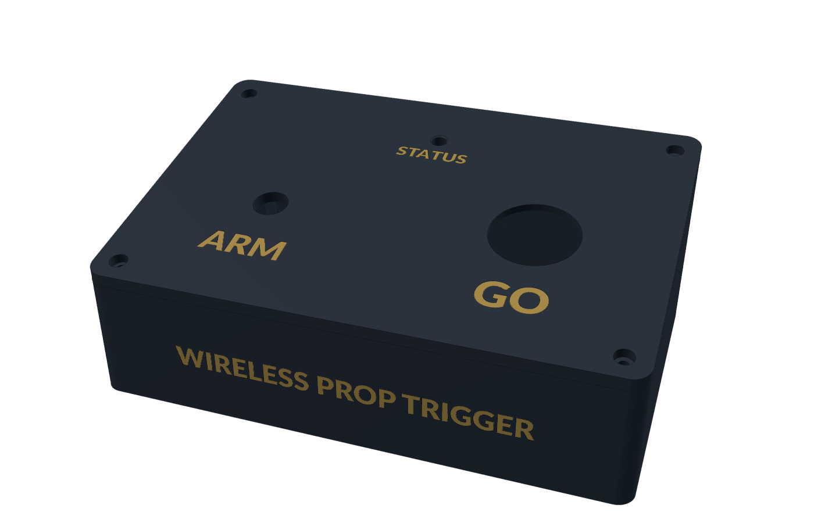
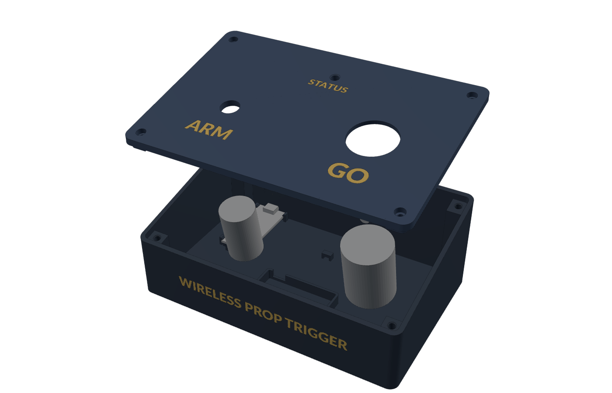
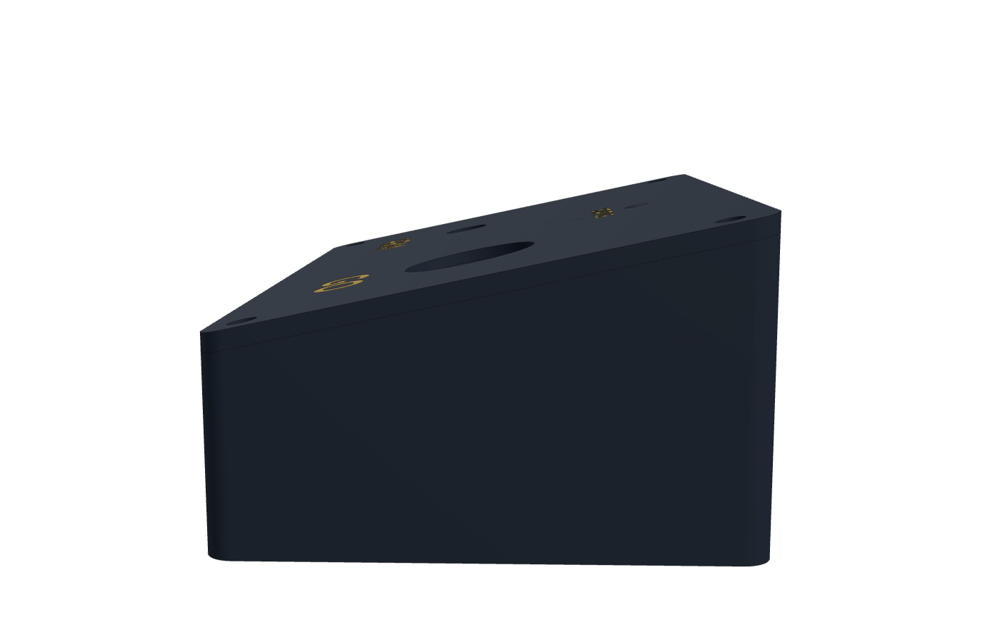
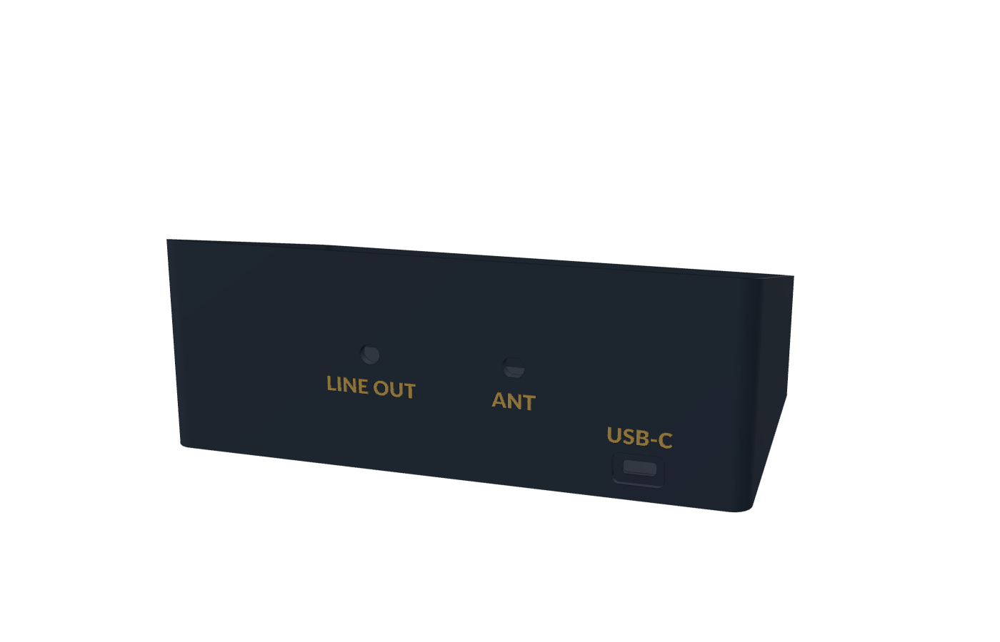
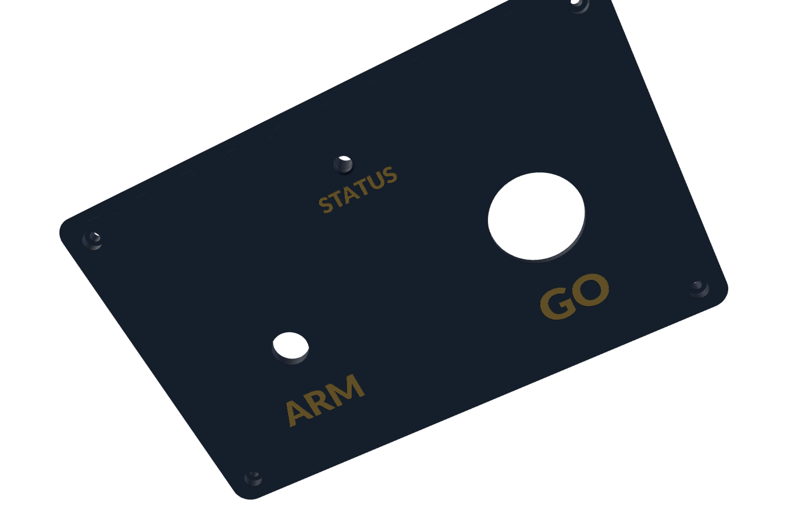

# Receiver case

A 3D-printable sloped desk console for the receiver. It has a base tray for the electronics and a control lid with the **ARM** flight switch, the **GO** arcade button and a **STATUS** LED. The labels print as two-colour inlays, and the case is held together with four M3 socket-head screws.



| | |
|---|---|
|  |  |
|  |  |

**Size:**
- **Footprint:** 180 × 115 mm.
- **Height:** 42 mm at the front, rising at **12°** to 66 mm at the back.
- **Depth under the lid:** at least 46 mm, enough for the switch and button bodies.

**Colours:** the previews use the WKGS palette, navy `#283341` with gold `#c09e50` text. A navy or dark-blue PLA with a gold PLA gets close.

## Layout

- **Top:** ARM switch on the left, a 30 mm GO button on the right, and the STATUS LED at the back centre.
  - The switch, button and screws all sit square to the sloped top.
  - Positions in the `.scad` are measured along the slope from the front edge.
- **Back panel:** USB-C (power, MIDI and charging), the ANT SMA bulkhead, and a 3.5 mm LINE OUT jack. Every cable leaves from the back.
- **Front:** the "WIRELESS PROP TRIGGER" title.
- **Inside:**
  - **Board:** the Challenger snaps into a cradle at the back-left. Its USB-C socket sits in a thinned section of wall, so any USB-C cable plugs fully home.
  - **DAC:** zip-tie loops for the PCM5102A module.
  - **Battery:** an optional LiPo bay with strap loops.

## Files

| File | What |
|---|---|
| `3mf/receiver_lid.3mf` | **Ready for PrusaSlicer.** Lid and text as one object: body on extruder 1, text on extruder 2. |
| `3mf/receiver_base.3mf` | Same, for the base. |
| `stl/receiver_lid.stl` + `stl/receiver_lid_text.stl` | Fallback if you'd rather assign parts yourself. The lid is already flipped top-face-down. |
| `stl/receiver_base.stl` + `stl/receiver_base_text.stl` | Fallback for the base. Print floor-down. |
| `stl/receiver_fit_panel.stl` | Test strip with the ARM, GO and LED holes. |
| `stl/receiver_fit_cradle.stl` | The corner of the base around the board: cradle, plus the back wall with the USB-C cut-out. |
| `receiver_case.scad` | Parametric source. Set `part` to export any of the above. |
| `make_3mf.py` | Rebuilds a 3MF from a body STL and a text STL. |

## Two-colour printing

Each label is a separate **inlay** part. It fills its recess in the body exactly, giving a flush, two-colour finish. The inlays are **1.0 mm** thick, about five layers, which is enough to stop a dark body showing through light text. Change `label_depth` to adjust it.

**Using the 3MFs in PrusaSlicer:**
1. Pick your printer:
   - **Prusa XL:** *Original Prusa XL – 2T*.
   - **i3:** your MK3.x or MK4 *MMU3* preset.
2. Open the 3MF. The text part is already on extruder 2.
3. Set filament 1 to the body colour and filament 2 to the text colour, then slice.

**Using the STLs instead:**
1. Select the body and its matching `_text` STL, and drag both in together.
2. Answer **Yes** to *"load as a single object with multiple parts"*. They stay aligned.
3. Right-click the text part and set its extruder to 2.

### Which printer for which part

I test-sliced both 3MFs on two extruders. They split as expected:

| Part | Where the text is | Tool changes | Best on |
|---|---|---|---|
| **Lid** | First ~5 layers (top face is on the bed) | **7** | Either. On the **MMU** this is only a few swaps. |
| **Base** | Vertical front and back walls, spread over ~30 layers | **~60** | **XL 2T**. Tool changes are quick and the purge is small. On the MMU, each change is a full filament swap and purge, which adds about an hour and a pile of purge waste. |

To skip the base labels entirely and keep the base single-colour, set `base_labels = false`.

**Spare MMU colours:** the lid could carry extra accents with the other three filaments, such as yellow/black hazard stripes round ARM or a red ring round GO. Ask if you want those added.

## Before you print the full case

The model uses typical sizes for each part. **Measure your actual flight switch and arcade button**, set them in the *Controls* section of the `.scad`, then print the two fit-test pieces. Each takes 20–30 minutes.

1. **`fit_panel`:**
   - The switch and button should fit their holes and their nuts or clips should grip.
   - The 5 mm LED should push up through its hole from below.
2. **`fit_cradle`:**
   - The Challenger should click down under the four corner lips.
   - The USB-C socket should line up with the wall opening, and a cable should plug fully in.
   - If a corner lip lands on a component, trim it with a knife.

Settings you may need to change:

| Variable | Default | Change it if… |
|---|---|---|
| `top_angle` | 12 | You want more or less slope. 0 gives a flat top. |
| `front_h` | 42 | Your switch or button bodies are deeper than about 40 mm. |
| `go_hole_d` | 30.2 | Your button is 24 mm (use 24.2), or a big dome; check its datasheet. |
| `go_panel_t` | 2.5 | Snap-in buttons need a thin panel (≤ 3 mm). Screw-nut buttons are fine at 4. |
| `arm_hole_d` / `arm_key_w` | 12.2 / 0 | Your missile switch has a different bushing or an anti-rotation tab. |
| `usb_z_above_pcb` | 1.63 | The USB-C opening is too high or low on the fit test. |
| `insert_d` | 4.0 | Your M3 inserts specify a different hole. Set `fastener = "tap"` to screw straight into plastic instead. |
| `battery_bay` | true | You're running from USB only. |

After changing sizes, re-export the parts and rebuild the 3MFs:

```
openscad -D 'part="lid"'       -o lid.stl       receiver_case.scad
openscad -D 'part="lid_text"'  -o lid_text.stl  receiver_case.scad
openscad -D 'part="base"'      -o base.stl      receiver_case.scad
openscad -D 'part="base_text"' -o base_text.stl receiver_case.scad
python make_3mf.py receiver_lid.3mf  "Receiver lid"  lid.stl  lid_text.stl
python make_3mf.py receiver_base.3mf "Receiver base" base.stl base_text.stl
```

The `check`, `check_board`, `check_lid` and `check_text` parts should all render **empty**. If one doesn't, a changed size has made parts collide.

The labels use **Lato Black**. If it isn't installed, OpenSCAD substitutes a default. Set `label_font` to change it.

## Printing

| | Base | Lid |
|---|---|---|
| Orientation | Floor on the bed | Top face on the bed (as exported) |
| Supports | None | None |
| Layer height | 0.2 mm | 0.2 mm |
| Walls / perimeters | 4 | 4 |
| Infill | 20% gyroid | 25% |

PLA+ or PETG both work. PETG is tougher if the box will be knocked around backstage. The base fits the i3 bed, but at 66 mm tall with labels on its walls it's the better job for the XL.

## Hardware

| Item | Qty |
|---|---|
| M3 × 10 socket head cap screw | 4 |
| M3 heat-set insert, about 5.7 mm long (4.0 mm hole) | 4 |
| 12 mm self-adhesive rubber bumper feet | 4 |
| Flight / missile toggle switch with flip cover (12 mm bushing) | 1 |
| 30 mm arcade button | 1 |
| 5 mm through-hole addressable LED (WS2812/PL9823 5 mm) | 1 |
| 3.5 mm stereo panel-mount jack (6 mm thread) | 1 |
| SMA bulkhead to U.FL pigtail + 868 MHz antenna | 1 |
| Zip ties (3 mm), foam tape, hook-and-loop strap | a few |

## Assembly

1. **Inserts:** press them into the four base posts with a soldering iron at about 220 °C. The post tops are sloped, so press each insert square to the post top, not straight down.
2. **Board:** press it down into the cradle, USB end first, until it clicks under the lips.
3. **DAC:** stick it down with foam tape between its two loops, then zip-tie it.
4. **Back panel:** fit the SMA bulkhead and the line-out jack. Wire the jack to the DAC's **LOUT**, **ROUT** and **AGND** pins.
5. **Lid:**
   - Fit the ARM switch, the GO button and the LED. The LED's rim sits in the tube under the lid; add a dab of hot glue.
   - Wire the switch and button to the board (see the main README).
   - Leave enough wire slack to open the lid fully.
6. **Close up:** drop the lid on (the skirt locates it) and fit the four M3 × 10 screws. Don't over-tighten into the inserts.
7. **Feet:** stick the four rubber feet into the recesses underneath.
